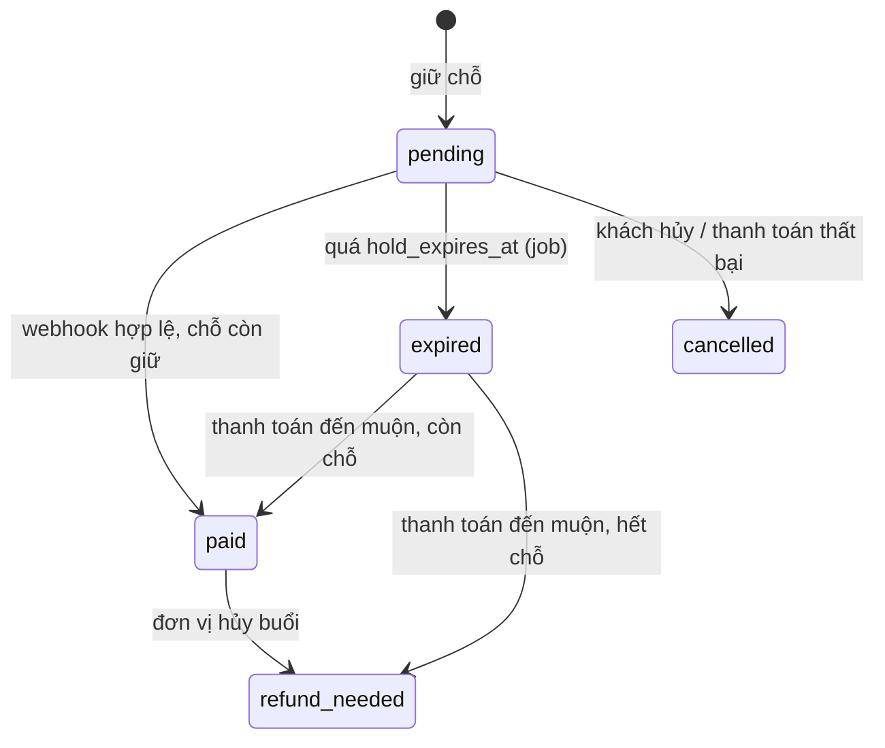

# Kiến trúc và quy tắc đặt chỗ, thanh toán

## Thành phần
```
Trình duyệt (Next.js) → API (Node.js) → PostgreSQL
                              ├──→ Dịch vụ ranker (Python/FastAPI)  [lỗi/chậm → xếp hạng dự phòng trong API]
                              └──→ PayOS  ⇄  webhook → API
```

## Luồng chính
1. Khách nhập bộ lọc + một câu nhu cầu.
2. API **lọc cứng bằng SQL** (ngày, giá, khu vực, loại, chỗ trống, workshop `approved`, buổi `scheduled`).
3. API gửi tập ứng viên + câu nhu cầu cho ranker; nhận danh sách đã xếp hạng. Lỗi/chậm quá `RANKER_TIMEOUT_MS` → xếp hạng dự phòng, ghi `search_logs.fallback_used = true`.
4. Khách chọn buổi, số người → API tạo booking `pending` và giữ chỗ (nguyên tử) → tạo thanh toán PayOS → trả `checkout_url`.
5. Khách trả tiền → PayOS gọi webhook → API xác thực, xử lý idempotent → booking `paid`, chuyển chỗ giữ thành chỗ bán, cấp vé.

## Trạng thái booking


## Giữ chỗ nguyên tử (BẮT BUỘC)
Trong một transaction:
```sql
-- 1. Giành chỗ; 0 dòng bị ảnh hưởng nghĩa là hết chỗ
UPDATE sessions
SET seats_held = seats_held + $qty
WHERE id = $session_id
  AND status = 'scheduled'
  AND starts_at > now()
  AND seats_held + seats_sold + $qty <= capacity
RETURNING id, price;

-- 2. Nếu có kết quả: tạo booking với giá lấy từ dòng vừa trả về (không lấy từ client)
INSERT INTO bookings (user_id, session_id, quantity, unit_price, total_amount,
                      hold_expires_at, order_code)
VALUES ($user, $session_id, $qty, $price, $price * $qty,
        now() + make_interval(mins => $hold_minutes), $order_code);
```
Ràng buộc `chk_capacity` trong DB là lưới an toàn cuối cùng.

## Hết hạn giữ chỗ (job chạy mỗi phút)
```sql
WITH expired AS (
  UPDATE bookings
  SET status = 'expired'
  WHERE status = 'pending' AND hold_expires_at < now()
  RETURNING session_id, quantity
)
UPDATE sessions s
SET seats_held = s.seats_held - agg.qty
FROM (SELECT session_id, sum(quantity) AS qty FROM expired GROUP BY session_id) agg
WHERE s.id = agg.session_id;
```
Job phải an toàn khi chạy chồng (không giải phóng một booking hai lần: điều kiện `status = 'pending'` đảm bảo điều này).

## Xử lý webhook (idempotent)
1. Đọc body thô, **xác thực chữ ký** theo tài liệu chính thức PayOS. Sai chữ ký → lưu `webhook_events` với `signature_valid=false`, trả lỗi, không xử lý.
2. `INSERT INTO webhook_events ... ON CONFLICT (provider, dedupe_key) DO NOTHING`. Nếu không chèn được (đã nhận trước đó) → trả thành công, không làm gì thêm (`outcome='duplicate'`).
3. Tìm booking theo `order_code`; kiểm tra số tiền khớp `total_amount`.
4. Booking `pending` → trong một transaction: `status='paid'`, `paid_at`, `seats_held -= qty`, `seats_sold += qty`, cấp `quantity` vé (`UNIQUE (booking_id, seq)` chống cấp trùng), cập nhật `payments`.
5. Luôn trả mã thành công cho nhà cung cấp sau khi lưu được sự kiện, để họ không gọi lại vô hạn.

## Thanh toán đến muộn (booking đã `expired`)
Trong một transaction thử giành lại chỗ bằng cùng câu `UPDATE` giữ chỗ:
- Còn chỗ → chuyển `paid`, bán chỗ, cấp vé (`outcome='late_payment_confirmed'`).
- Hết chỗ → booking `refund_needed` (`outcome='late_payment_no_seat'`); hoàn tiền thủ công, ngoài phạm vi.

## Hủy buổi bởi đơn vị tổ chức
Buổi → `cancelled`; mọi booking `paid` của buổi → `refund_needed`; booking `pending` → `cancelled` và giải phóng `seats_held`. Doanh thu loại các buổi `cancelled` (xem view `v_organizer_revenue`).

## Interface thanh toán
```ts
interface PaymentProvider {
  createPayment(input: { orderCode: number; amount: number; description: string;
                         returnUrl: string; cancelUrl: string }): Promise<{ checkoutUrl: string; providerRef?: string }>;
  verifyWebhook(rawBody: string, headers: Record<string, string>):
    { valid: boolean; dedupeKey: string; orderCode: number; amount: number; success: boolean };
}
```
Cài đặt đầu tiên: `PayOSProvider`. Thêm `MockProvider` cho test và demo (phát webhook giả bằng cùng đường xử lý).

## Phân quyền
- Middleware xác định `role` và, với organizer, `organizer_id` từ user đăng nhập.
- Repository của organizer **luôn** nhận `organizer_id` làm tham số và đưa vào mệnh đề `WHERE`; không có hàm truy vấn organizer nào bỏ qua tham số này.
