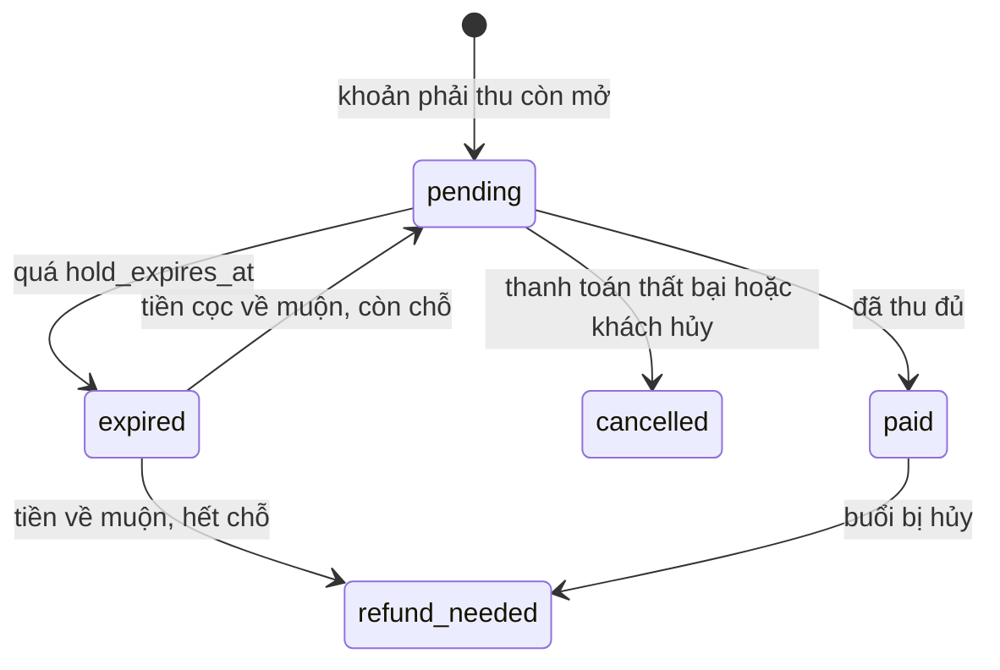

# Kiến trúc và quy tắc đặt chỗ, thanh toán

## Thành phần

```
Trình duyệt (React SPA) → API (Node.js/Express) → PostgreSQL
                              ├──→ Dịch vụ ranker (Python/FastAPI)  [lỗi/chậm → xếp hạng dự phòng trong API]
                              └──→ PayOS  ⇄  webhook → API
```

## Luồng chính

1. Khách nhập bộ lọc + một câu nhu cầu.
2. API **lọc cứng bằng SQL** (ngày, giá, tỉnh/thành, khu vực tùy chọn, loại, chỗ trống, workshop và studio `approved`, buổi `scheduled`). Địa điểm lưu trên studio: `province_id` bắt buộc với studio mới, `area_id` tùy chọn; workshop kế thừa địa điểm qua `studio_id`. Danh mục tỉnh/thành được đọc từ bảng `provinces`, không hard-code danh sách trong luồng lọc. Không dùng quận/huyện làm bộ lọc. Ngày lịch được hiểu theo `Asia/Ho_Chi_Minh`; truy vấn dùng khoảng nửa mở và chuyển ngày bằng `AT TIME ZONE`, không phụ thuộc múi giờ phiên DB.
3. API gửi tập ứng viên + câu nhu cầu cho ranker; nhận danh sách đã xếp hạng. Lỗi/chậm quá `RANKER_TIMEOUT_MS` → xếp hạng dự phòng, ghi `search_logs.fallback_used = true`.
4. Khách chọn buổi, số người và nhập thông tin liên hệ. API tính giá từ session, áp dụng tiền cọc của studio đủ điều kiện, rồi giữ chỗ bằng một câu `UPDATE` nguyên tử.
5. Đơn có tiền cọc được giữ chỗ tạm thời trong `HOLD_MINUTES` và nhận liên kết PayOS; đơn còn lại xác nhận chỗ và thanh toán tại studio. Đơn miễn phí được xác nhận ngay.
6. Webhook PayOS xác thực chữ ký và số tiền, ghi sự kiện chống trùng, chuyển chỗ giữ thành chỗ bán, cập nhật khoản đã thu và cấp vé. Khách xem lịch sử, trạng thái thanh toán và mã QR vé trong tài khoản; thông báo được lưu trong ứng dụng.

PayOS hiện thu tiền cọc vào một tài khoản nền tảng; chưa có chia tiền tự động. Studio đối soát/chuyển khoản thủ công cho MVP. Email không thuộc phạm vi hiện tại.

## Trạng thái booking



`bookings.status` biểu thị vòng đời thanh toán; `bookings.reservation_status` biểu thị riêng chỗ `pending`, `confirmed` hoặc `cancelled`. Với đơn cọc, webhook xác nhận chỗ ngay sau khi thu cọc nhưng `status` vẫn `pending` cho tới khi studio xác nhận khoản còn lại; khi đó vé đã được cấp. `paid_amount`, các dòng `payments` và `balance_amount` là nguồn hiển thị số tiền đã thu/còn phải thu.

## Giữ chỗ nguyên tử (BẮT BUỘC)

Trong một transaction:

```sql
-- 1. Giành chỗ; 0 dòng bị ảnh hưởng nghĩa là hết chỗ
UPDATE sessions
SET seats_held = seats_held + $qty
WHERE id = $session_id
  AND status = 'scheduled'
  AND starts_at > now()
  AND seats_held + seats_sold + $qty <= capacity
RETURNING id, price;

-- 2. Nếu có kết quả: tạo booking với giá lấy từ dòng vừa trả về (không lấy từ client)
INSERT INTO bookings (user_id, session_id, quantity, unit_price, total_amount,
                      hold_expires_at, order_code)
VALUES ($user, $session_id, $qty, $price, $price * $qty,
        now() + make_interval(mins => $hold_minutes), $order_code);
```

Ràng buộc `chk_capacity` trong DB là lưới an toàn cuối cùng.

## Thứ tự khóa và hết hạn giữ chỗ

Mọi transaction tác động đồng thời đến chỗ và booking phải lấy khóa theo thứ tự:

1. Khóa các dòng `sessions` liên quan theo `id` tăng dần.
2. Cập nhật các dòng `bookings`.
3. Cập nhật bộ đếm chỗ trong `sessions`.

Áp dụng thứ tự này cho giữ chỗ, hết hạn, hủy buổi và thanh toán/webhook. Khi có nhiều session, khóa toàn bộ theo thứ tự ổn định trước khi cập nhật booking. Cleanup chỉ đổi booking `pending` đang giữ chỗ đã hết hạn; `RETURNING` rồi cộng `quantity` theo session để trừ `seats_held` trong cùng transaction. Nếu số chỗ giữ không đủ để trừ, rollback toàn transaction thay vì tạo số dư sai. Điều kiện trạng thái và transaction khiến cleanup chạy lặp hoặc chạy đồng thời chỉ giải phóng mỗi booking một lần. Worker chạy mỗi `EXPIRY_JOB_INTERVAL_SECONDS` (mặc định 60 giây), dùng advisory transaction lock để tránh xử lý chồng giữa các tiến trình.

### Giải phóng khi truy cập (bắt buộc, không chỉ dựa vào job)

Dịch vụ host miễn phí có thể ngủ nên job định kỳ không đủ. Cleanup khi đọc phải giới hạn vào các session công khai phù hợp với truy vấn:

1. `POST /bookings`: khóa session được đặt, cleanup hold hết hạn của session **trong cùng transaction và trước** câu UPDATE giữ chỗ.
2. `GET /workshops` và `/catalog/studios`: scope theo các bộ lọc truy vấn, nhưng không dùng điều kiện chỗ trống khi chọn session cần cleanup; hold hết hạn có thể là lý do session trông như đã bán hết.
3. `GET /workshops/:id` và `/studios/:id`: scope theo workshop hoặc studio được yêu cầu.
4. Danh sách tỉnh/khu vực: scope theo tỉnh/khu vực tương ứng trước khi tính studio có buổi còn chỗ.

Không dùng một truy vấn đọc catalog để cập nhật booking hết hạn ngoài phạm vi kết quả người dùng đang yêu cầu; worker nền riêng được phép dọn toàn cục theo batch.

## Xử lý webhook (idempotent)

1. Đọc body thô, **xác thực chữ ký** theo tài liệu chính thức PayOS. Sai chữ ký → lưu `webhook_events` với `signature_valid=false`, trả HTTP không-2xx, không xử lý booking.
2. Với chữ ký hợp lệ, `INSERT INTO webhook_events ... ON CONFLICT (provider, dedupe_key) DO NOTHING`. Nếu đã nhận trước đó → trả HTTP 2xx, không làm gì thêm (`outcome='duplicate'`).
3. Tìm payment cọc theo `order_code`; kiểm tra số tiền khớp `payments.amount` và `bookings.deposit_amount`.
4. Nếu cọc thành công và giữ chỗ còn hiệu lực, trong một transaction theo thứ tự khóa chung (session trước, booking sau): xác nhận chỗ, chuyển `seats_held` sang `seats_sold`, cập nhật `paid_amount`/`payments`, cấp `quantity` vé (`UNIQUE (booking_id, seq)` chống cấp trùng). Đơn cọc còn số dư vẫn có `status='pending'` cho tới khi studio xác nhận phần còn lại.
5. Với webhook có chữ ký hợp lệ, trả HTTP 2xx sau khi sự kiện đã được lưu và xử lý được kết quả cuối cùng (kể cả sự kiện trùng, sai số tiền hoặc booking không thể xác nhận). Nếu lỗi tạm thời khiến chưa lưu hoặc xử lý được, trả lỗi để nhà cung cấp có thể gửi lại. Phản hồi thực tế phải tuân theo hợp đồng webhook chính thức của PayOS.

Khách rời trang checkout hoặc quay về `/payment/cancel` không tự xác nhận thanh toán. Khách có thể chủ động hủy qua `POST /bookings/:id/cancel` nếu còn trong thời hạn chính sách; chỗ được trả trong cùng transaction. Khoản đã thu chuyển sang `refund_needed` để studio hoàn thủ công. Nếu không thao tác, hold hết hạn được dọn bởi worker và tại đầu luồng đặt chỗ/đọc số chỗ.

## Thanh toán đến muộn (booking đã `expired`)

Trong một transaction, khóa session trước booking rồi thử giành lại chỗ bằng cùng câu `UPDATE` giữ chỗ:

- Còn chỗ → chuyển `paid`, bán chỗ, cấp vé (`outcome='late_payment_confirmed'`).
- Hết chỗ → booking `refund_needed` (`outcome='late_payment_no_seat'`); hoàn tiền thủ công, ngoài phạm vi.

## Hủy buổi bởi đơn vị tổ chức

Buổi → `cancelled`; mọi booking `paid` của buổi → `refund_needed`; booking `pending` → `cancelled` và giải phóng `seats_held`. Doanh thu loại các buổi `cancelled` (xem view `v_studio_revenue`).

## Interface thanh toán

```ts
interface PaymentProvider {
  createPayment(input: {
    orderCode: number;
    amount: number;
    description: string;
    returnUrl: string;
    cancelUrl: string;
  }): Promise<{ checkoutUrl: string; providerRef: string | null }>;
  verifyWebhook(rawBody: string): {
    signatureValid: boolean;
    dedupeKey: string;
    orderCode: number | null;
    amount: number | null;
    providerRef: string | null;
    success: boolean;
  };
}
```

Cài đặt: `PayOSProvider` và `MockProvider` cho phát triển/test. Mock xác nhận dùng cùng hàm xử lý webhook idempotent; production bắt buộc cấu hình PayOS. `PAYOS_RETURN_URL` và `PAYOS_CANCEL_URL` chỉ điều hướng trình duyệt; trạng thái thanh toán chỉ được cập nhật theo webhook đã xác thực.

## Phân quyền

- Vai trò hệ thống của user là `customer` hoặc `admin`; `owner`/`staff` là vai trò theo studio trong `studio_members`.
- Repository quản lý **luôn** nhận `studio_id` và `user_id` làm tham số, xác minh thành viên qua `studio_members` trong truy vấn; không suy quyền từ vai trò toàn cục hoặc địa lý.
