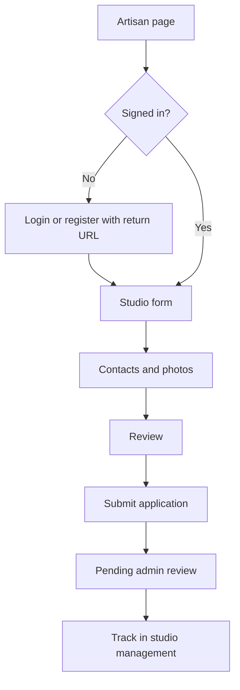

> Luồng hiện tại: đăng nhập trước khi mở form. Hồ sơ bắt buộc có cả số điện thoại, email liên hệ và 3–8 ảnh đã tải lên/xác nhận. Tỉnh/thành lấy từ `packages/shared/src/provinces.ts`, không gọi API. Xem `docs/studio-images.md` cho hợp đồng ảnh và điều kiện cọc hiện tại.

# Luồng nghệ nhân và đăng ký studio

Giữ hệ thống tài khoản hiện có: người đăng ký vẫn có role hệ thống `customer` hoặc `admin`; sau khi tạo hồ sơ, database ghi membership `owner` cho studio đó. Một tài khoản có thể sở hữu hoặc tham gia nhiều studio.

- `/danh-cho-nghe-nhan`: giải thích điều kiện, thông tin cần chuẩn bị, quy trình và câu hỏi thường gặp. Người đã có studio được ưu tiên quản lý/theo dõi, vẫn có thể đăng ký studio khác.
- `/dang-ky-studio`: bước thông tin và bước xem lại. Khách phải đăng nhập/tạo tài khoản trước khi vào form; redirect quay lại đúng trang đăng ký studio.
- Mọi lần xem lại hoặc gửi đều kiểm tra Zod, gồm lĩnh vực đang hoạt động và tỉnh/thành trong danh mục. Schema dữ liệu chung nằm ở `packages/shared/src/studio-registration.ts`; API giữ default `other` cho client cũ không gửi category.
- Bản nháp lưu bằng `sessionStorage`, tách key theo tài khoản. Khi khách chủ động đi đăng nhập/đăng ký, đánh dấu chuyển bản nháp guest sang tài khoản vừa xác thực. Strict Mode không được làm mất bản nháp. Dữ liệu lưu không hợp lệ được bỏ qua; khi trình duyệt chặn lưu, giao diện thông báo giới hạn này.
- Xem lại không tạo dữ liệu. Đăng nhập xong cũng không tự gửi: người dùng phải bấm “Gửi hồ sơ xét duyệt”. Nút và ref khóa lần gửi đang chạy; lỗi vẫn giữ nội dung để thử lại.
- API trả hồ sơ thật vừa tạo. Giao diện dùng id đó cho biên nhận và link quản lý, xóa bản nháp sau thành công, đồng thời làm mới danh sách studio để cập nhật menu.
- Trang quản lý hiển thị trạng thái `pending`, `approved`, `rejected`. Chỉ hiện link trang công khai khi được duyệt. Danh sách Khám phá còn yêu cầu workshop được duyệt và có lịch phù hợp.

Chưa có API sửa/gửi lại hồ sơ studio. Hồ sơ chưa được duyệt hiện hướng dẫn liên hệ hỗ trợ; không hứa khả năng sửa hoặc thời hạn xét duyệt mà hệ thống chưa cung cấp.

Một studio có nhiều workshop và được chọn nhiều loại workshop khi đăng ký. Form dùng checkbox, cần chọn ít nhất một loại; bước xem lại và bản nháp giữ toàn bộ lựa chọn. Danh mục của từng workshop độc lập với danh sách loại của studio, nên nghệ nhân vẫn có thể mở thêm trải nghiệm mới. Form đăng ký và tạo workshop cho phép chọn “Khác” kể cả khi danh mục này chưa mang trạng thái active. Nghệ nhân có thể đăng trải nghiệm mới bằng tên và mô tả riêng, không cần có sẵn workshop cùng loại trên hệ thống. Workshop mới vẫn chờ admin duyệt.

Migration `011_studio_categories.sql` tạo bảng liên kết studio–danh mục, bật RLS không policy và chuyển loại hiện tại của từng studio sang bảng mới. API tạo studio nhận `categoryIds` (không rỗng, không trùng, phải tồn tại trong danh mục), lưu cùng transaction với studio và membership. `categoryId` vẫn giữ loại đầu tiên để tương thích client cũ; client cũ không gửi `categoryIds` được chuyển thành một lựa chọn. API tạo studio và `/me/studios` trả danh sách `categoryIds`; trang quản lý hiển thị tên các loại đã chọn. Bản nháp cũ có một `categoryId` được khôi phục thành danh sách một phần tử. Chưa bổ sung API chỉnh sửa hồ sơ studio đã gửi.

## Đề xuất danh mục workshop

- Khi đăng ký studio, chọn “Khác” sẽ hiện ô **Loại workshop khác** bắt buộc (2–80 ký tự, ví dụ “Thêu tay”). Đây là tên loại, không phải tên trải nghiệm hay buổi tổ chức; chọn nhiều loại cũng không tự tạo workshop. Bỏ chọn “Khác” xóa nội dung đề xuất khỏi form. Bản nháp và bước xem lại giữ tên đề xuất.
- Migration `012_studio_category_proposals.sql` lưu `studios.proposed_category_name` riêng tư. API tạo studio và DTO quản lý/admin trả trường này; DTO công khai không trả. Client cũ chỉ gửi `categoryId` vẫn có thể dùng “Khác” không kèm đề xuất; request mới gửi `categoryIds` có “Khác” bắt buộc nhập tên loại.
- Admin thấy đề xuất trong hồ sơ và nút **Duyệt studio và danh mục**. Duyệt dùng lại danh mục trùng tên hoặc tạo danh mục active mới, thay “Khác” bằng danh mục được duyệt trong `studio_categories`, giữ các loại đã chọn còn lại và xóa đề xuất đang chờ. Thao tác cùng transaction với duyệt studio; dùng cùng khóa tạo danh mục với luồng workshop để tránh trùng khi duyệt đồng thời. Từ chối không tạo danh mục và giữ đề xuất trong hồ sơ. Danh mục cache phía web được làm mới sau khi duyệt.
- Sau khi studio được duyệt, chủ studio tạo từng workshop cụ thể (ví dụ “Thêu túi tote cho người mới”), chọn danh mục vừa được duyệt, rồi thêm các buổi có ngày giờ, giá và số chỗ. Workshop vẫn cần được xét duyệt riêng.

- Trong form tạo/sửa workshop, chọn “Khác”, tick “Đề xuất danh mục mới cho workshop này” rồi nhập tên 2–80 ký tự. Không tick vẫn được lưu workshop thuộc “Khác”.
- `proposedCategoryName` là trường riêng tư trong DTO quản lý/admin, không xuất hiện trong DTO công khai. Schema Zod chung kiểm tra tên và yêu cầu `categoryId=other` khi gửi đề xuất, kể cả PATCH. Sửa danh mục mà không gửi đề xuất sẽ xóa đề xuất cũ.
- Migration `009_workshop_category_proposals.sql` bổ sung trường nullable trên workshop; `010_workshop_category_review.sql` lưu tên danh mục vào lịch sử duyệt, tách khỏi lý do từ chối. Chưa tạo category khi nghệ nhân gửi, nên đề xuất chưa duyệt không lọt ra danh sách `/categories`.
- Admin thấy tên đề xuất và nút “Duyệt workshop và danh mục”. Duyệt dùng lại danh mục trùng tên (không phân biệt hoa thường/khoảng trắng), hoặc tạo danh mục active mới, gán lại workshop và xóa đề xuất. Tất cả diễn ra cùng transaction với lịch sử duyệt; khóa transaction ngăn hai lần duyệt đồng thời tạo hai danh mục trùng tên. Nội dung duyệt danh mục được ghi vào lịch sử.
- Từ chối không tạo danh mục, giữ đề xuất để nghệ nhân sửa/gửi lại. Đổi nội dung workshop đã duyệt vẫn đưa workshop về chờ duyệt theo quy tắc hiện có.
- Form workshop tải danh mục từ API, vì vậy danh mục được duyệt có thể được chọn cho các workshop tiếp theo. Danh mục mới dùng ảnh mặc định; nghệ nhân không tự đặt metadata công khai ngoài tên đã được admin duyệt.

Kiểm chứng bằng browser script `output/studio-onboarding-check.mjs` với API giả lập: responsive 1440/768/390, lỗi từng ô, xem lại, giữ nháp sau refresh/đăng nhập/tạo tài khoản, lỗi gửi, chống gửi lặp khi pending, biên nhận/xóa nháp và ba trạng thái duyệt. Script không tạo tài khoản hoặc studio thật.
