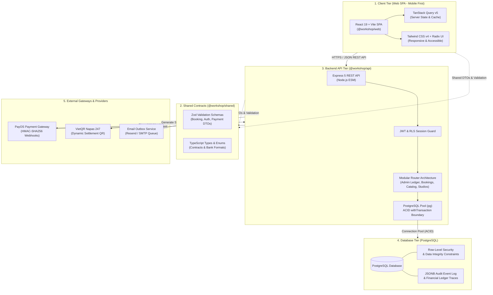
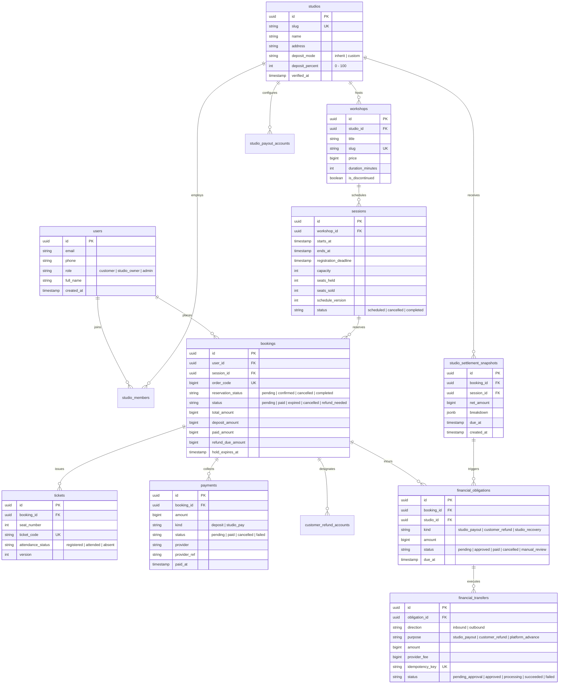
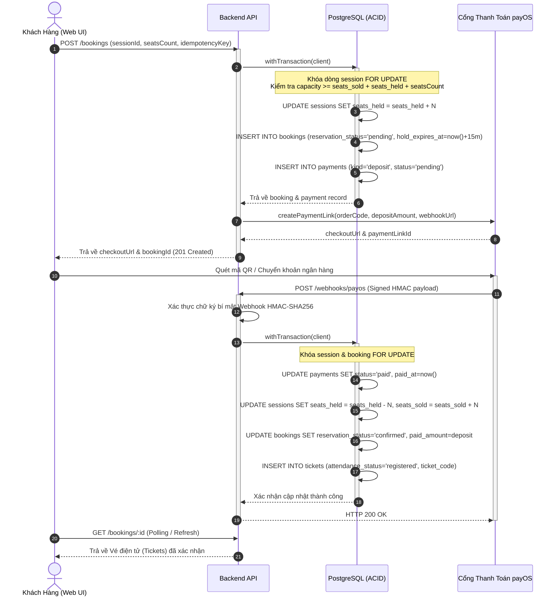
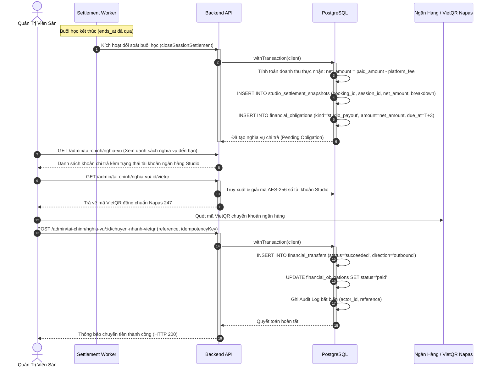
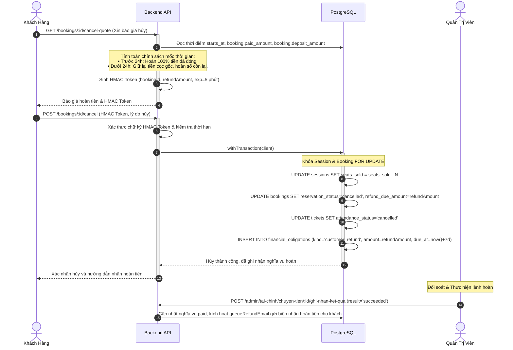

# Báo Cáo Kiến Trúc Hệ Thống & Thiết Kế Kỹ Thuật (Phục vụ Đồ Án Tốt Nghiệp)

> **Dự án**: Open Slot — Nền tảng Đặt chỗ & Quản lý Workshop Thủ công & Nghệ thuật
> **Cập nhật**: Tháng 11/2026  
> **Tài liệu liên quan**: [Mục lục tổng quan](../README.md) · [Kiến trúc hệ thống](02-architecture.md) · [Đặc tả API](03-api-spec.md) · [Danh mục tài liệu](../danh-muc-tai-lieu.md)

---

## 1. Tổng quan Kiến trúc Hệ thống (System Architecture Overview)

Hệ thống **Open Slot** được thiết kế theo mô hình Monorepo hiện đại, tối ưu hóa cho độ tin cậy giao dịch (transactional reliability), tính nhất quán dữ liệu tài chính (ACID) và trải nghiệm người dùng di động (Mobile-First SPA).

### Công nghệ Cốt lõi (Tech Stack Matrix)

| Tầng (Tier)         | Công nghệ / Thư viện                               | Vai trò & Đặc điểm kiến trúc                                                                                  |
| :------------------ | :------------------------------------------------- | :------------------------------------------------------------------------------------------------------------ |
| **Frontend Web**    | React 19, TypeScript, Vite 6                       | SPA dựng theo chuẩn Mobile-First, tối ưu bundle size với code-splitting qua `manualChunks`.                   |
| **Giao diện & UI**  | Tailwind CSS v4, Radix UI Primitives, Lucide Icons | Thiết kế chuẩn mực, đáp ứng truy cập a11y, zero layout shift (CLS).                                           |
| **Quản lý State**   | TanStack Query v5                                  | Bộ nhớ đệm server-state thông minh, tự động revalidate và đồng bộ hóa optimistic UI.                          |
| **Backend API**     | Express 5, Node.js 22 (ESM)                        | Kiến trúc định tuyến theo module phân tán (`ledger/`, `catalog/`, `bookings/`), xử lý đồng thời non-blocking. |
| **Tính hợp lệ**     | Zod (End-to-End Validation)                        | Giao thức dữ liệu đồng nhất giữa Client và Server thông qua workspace `@workshop/shared`.                     |
| **Cơ sở dữ liệu**   | PostgreSQL 16                                      | RLS (Row Level Security), quan hệ khóa ngoại bảo đảm toàn vẹn tham chiếu, giao dịch ACID nghiêm ngặt.         |
| **Thanh toán & QR** | PayOS SDK & VietQR Napas 247                       | Thanh toán trực tuyến tự động qua cổng bảo mật và giải ngân VietQR chuẩn ngân hàng.                           |

---

## 2. Mô hình Thực thể Quan hệ (ERD - Entity Relationship Diagram)

Hệ thống lưu trữ mô hình dữ liệu workshop đa phiên (multi-session), ràng buộc sức chứa thời gian thực, quản lý phân bổ vé và sổ cái nghĩa vụ tài chính bất biến.

---

## 3. Các Biểu Đồ Tuần Tự Trọng Yếu (Core Sequence Diagrams)

### Luồng 1: Giữ Chỗ & Đặt Cọc Trực Tuyến (Atomic Seat Hold & Payment Checkout)

Quy trình bảo đảm không bán vượt sức chứa (overbooking) bằng cơ chế khóa bi-directional nguyên tử trong giao dịch PostgreSQL:

---

### Luồng 2: Quyết Toán Tự Động & Chi Trả Studio (Automated Settlement & Payout)

Quy trình quyết toán định kỳ hoặc sau khi buổi workshop kết thúc thành công:

---

### Luồng 3: Hủy Chỗ & Hoàn Tiền Đa Mốc (Tiered Cancellation & Refund Policy)

Cơ chế chống giả mạo chính sách hoàn tiền bằng mã định danh mật mã HMAC Token có thời hạn 5 phút:

---

## 4. Tối Ưu Hóa Frontend & Web Vitals (Performance Engineering)

### Kết quả Tái cấu trúc Kiến trúc Codebase (Refactoring Highlights)

Nhằm đáp ứng tiêu chuẩn khắt khe của Đồ án Tốt nghiệp ngành Kỹ thuật Phần mềm, toàn bộ codebase đã trải qua 4 giai đoạn chuẩn hóa kiến trúc:

1. **Phân tách Component Khổng lồ (De-monolith Components)**:
   - `StudioFinancesManager.tsx` (598 dòng → 157 dòng): Tách thành 4 sub-components chuyên trách (`FinanceMetricsSummary`, `FinanceAccountBanner`, `SettlementsTable`, `UpcomingBookingsTable`).
   - `WorkshopEditorSheet.tsx` (595 dòng → 274 dòng): Tách thành 4 fieldsets độc lập (`WorkshopBasicFields`, `WorkshopPricingFields`, `WorkshopDetailFields`, `WorkshopPolicyFields`).
   - `WorkshopSchedule.tsx` (535 dòng → 350 dòng): Tách các phần tử tương tác (`ScheduleSessionPicker`, `SchedulePriceBreakdown`, `ScheduleStickyBar`).
   - `SiteHeader.tsx` (471 dòng → 240 dòng): Tách menu và drawer di động (`HeaderUserMenu`, `HeaderMobileDrawer`).

2. **Chuẩn hóa Đường dẫn Tuyệt đối `@/...` (Path Aliases)**:
   - Loại bỏ triệt để các đường dẫn tương đối sâu dễ gây lỗi (`../../../../components/`, `../../lib/`).
   - Cấu trúc thư viện `src/lib/` phân lớp rõ ràng theo domain: `core/`, `api/`, `domain/`, `prefetch/`, `assets/`.

3. **Mô-đun hóa Sổ Cái Tài Chính Backend (`financial-ledger.ts`)**:
   - Tách file nguyên khối 1,553 dòng thành 5 route handlers phân nhiệm độc lập trong thư mục `apps/api/src/modules/admin/ledger/`:
     - `calendar.routes.ts`: Quản lý ngày làm việc và lịch nghỉ lễ theo luật định.
     - `obligations.routes.ts`: Nghĩa vụ tài chính và đối soát dòng tiền.
     - `transfers.routes.ts`: Lệnh chuyển khoản, duyệt chi và đồng bộ cổng thanh toán.
     - `accounts.routes.ts`: Xác minh và duyệt tài khoản ngân hàng thụ hưởng.
     - `fees.routes.ts`: Đối chiếu và thu phí nền tảng sàn giao dịch.

4. **Tối ưu Hóa Bundle Size & Mobile Web Vitals**:
   - **Code Splitting**: Cấu hình `manualChunks` tách biệt `vendor-react`, `vendor-query`, `vendor-radix` giúp trình duyệt client tận dụng bộ nhớ đệm HTTP Cache dài hạn.
   - **LCP (Largest Contentful Paint)**: Tối ưu ảnh bìa workshop bằng định dạng WebP nén sẵn, chỉ định rõ thuộc tính `width`, `height` và `fetchpriority="high"`.
   - **CLS (Cumulative Layout Shift) = 0**: Thiết lập khung giữ chỗ (`aspect-ratio: 16/9`) và Skeleton placeholders cho tất cả danh sách tải bất đồng bộ.
   - **INP (Interaction to Next Paint) < 50ms**: Tối ưu hóa render tree thông qua Memoization và TanStack Query cache deduplication.

---

## 5. Kết Luận

Kiến trúc hệ thống **Open Slot** giải quyết trọn vẹn bài toán thực tế của thị trường workshop thủ công:

- Đảm bảo **an toàn tuyệt đối về mặt tài chính và dữ liệu giao dịch** nhờ cơ chế khóa nguyên tử ACID và nhật ký kiểm toán không thể xóa sửa.
- Mang lại **trải nghiệm di động vượt trội** nhờ kiến trúc SPA tinh gọn, phân tách mô-đun bài bản và tuân thủ các chuẩn mực phát triển phần mềm hiện đại.
